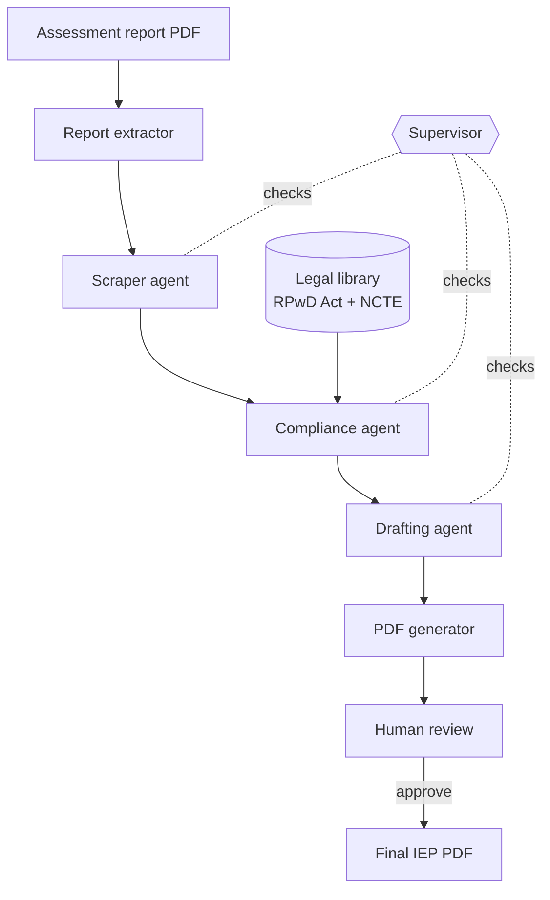

# SAMARTH — AI-Assisted IEP Generation for Indian Schools

SAMARTH turns a student's psychoeducational assessment report into a draft **Individualized Education Program (IEP)** aligned with the **Rights of Persons with Disabilities (RPwD) Act, 2016** and **NCTE/NCERT** guidelines, in the **NASET 11-section format**. A teacher then reviews, corrects and approves it before it is finalised.

> **SAMARTH produces a draft, not a decision.** Every IEP must be reviewed and approved by a qualified educator. The human review step is a required part of the workflow, not an optional extra.

---

## The problem

Indian law requires schools to support children with disabilities through individualised plans. Delhi's Directorate of Education, for example, requires an IEP for every child with a disability in government and aided schools, prepared within 15 days. Writing one well takes a trained special educator several hours: reading the assessment, describing present levels across several areas, writing measurable goals, and listing every accommodation the law entitles the child to.

There are far fewer special educators than children who need IEPs. SAMARTH lets a general classroom teacher produce a legally grounded first draft from an assessment report, so specialist time goes into reviewing and refining rather than writing from scratch.

## What makes it different from prompting an LLM directly

A single prompt to a capable model can produce a plausible IEP. It cannot guarantee one. SAMARTH wraps the model in deterministic layers so that the parts which must be correct are enforced by code:

- **Legally required accommodations cannot be dropped.** A rule-based baseline of what the RPwD Act requires for each disability category is merged with the model's suggestions. The model can add to the list; it cannot remove from it.
- **Legal text is retrieved, not recalled.** The compliance agent searches the actual RPwD Act and NCTE guidelines (retrieval-augmented generation) rather than relying on the model's memory.
- **Dates are computed, not invented.** Service start, academic-year end and annual review dates are calculated in code and given to the model.
- **Citations are restricted** to legal provisions that were actually retrieved.
- **Diagnoses are translated** from clinical (DSM-5) language into the RPwD Act's disability categories by an explicit mapping.
- **Every human edit is recorded.** The original AI output is preserved, and each field is marked as AI- or human-authored, with the reviewer's identity taken from their login.

---

## How it works



The agents are orchestrated with **LangGraph**. They share one state object (`IEPState`): each agent reads what it needs and adds its own output. After every step a rule-based **supervisor** checks that the step produced valid output, then routes to the next agent or stops the run.

| Step | What it does | Main technique |
|---|---|---|
| **Report extractor** | Reads the PDF and extracts name, age, grade, diagnosis, severity and a narrative summary | Multimodal LLM with schema-constrained JSON output; DSM-5 → RPwD mapping; content-hash cache |
| **Scraper agent** | Turns the narrative into strengths, challenges, learning style, supports and goals | Zero-shot, schema-guided information extraction with validation |
| **Compliance agent** | Determines what the law requires for this student | RAG over the legal corpus (embeddings + HNSW nearest-neighbour search, cosine similarity), LLM audit, deterministic baseline merge |
| **Drafting agent** | Writes the 14 IEP sections | Constraint-grounded generation: computed dates, accommodation checklist, citation whitelist; output validation |
| **PDF generator** | Builds the NASET-format document | ReportLab; Section 1 rendered from structured data |
| **Human review** | Teacher edits, approves and rebuilds the PDF | Field-level provenance tracking; validated, all-or-nothing edits; no AI calls |

### Reliability

- **Model fallback.** Every Gemini call goes through one shared function that tries an ordered chain of models. If a model is overloaded, rate-limited or retired (HTTP 503 / 429 / 500 / 404), the next model is tried immediately.
- **Record / replay.** In `replay` mode, identical prompts return previously recorded responses with no API call — useful for development and demos without spending quota.
- **JSON repair.** Malformed model output (trailing commas, unescaped newlines, smart quotes) is repaired before parsing.

### Security

- **Accounts are created by an administrator.** There is no public sign-up, because IEPs contain children's disability information.
- **Passwords** are stored as salted **scrypt** hashes; login uses **JWT** bearer tokens (HS256) that expire after 8 hours by default.
- **Educators see only their own IEPs.** Requests for another educator's IEP return `404` rather than `403`, so the system does not confirm that the record exists.
- **Administrators manage accounts but cannot read IEPs** (least privilege).
- **Deactivating an account takes effect immediately**, including for sessions already in progress.

---

## Tech stack

| Layer | Technology |
|---|---|
| Agent orchestration | LangGraph |
| Language models | Google Gemini 3.x Flash family (via `google-genai`), with automatic fallback |
| Embeddings | `gemini-embedding-2` |
| Vector database | ChromaDB (persistent, cosine similarity) |
| Backend | FastAPI, Python 3.13 |
| Accounts database | SQLite via SQLModel (PostgreSQL-ready) |
| Authentication | PyJWT, `hashlib.scrypt` |
| PDF generation | ReportLab |
| Frontend | React 19, Vite, Phosphor Icons |

---

## Project structure

```
SAMARTH/
├── agents/
│   ├── graph.py              # LangGraph wiring
│   ├── state.py              # Shared IEPState
│   ├── supervisor_agent.py   # Rule-based routing
│   ├── scraper_agent.py
│   ├── compliance_agent.py
│   ├── drafting_agent.py
│   └── model_config.py       # Model chains, fallback, record/replay
├── app/
│   ├── main.py               # FastAPI app
│   ├── db.py                 # User table, database setup
│   ├── cli.py                # Account management CLI
│   ├── routers/
│   │   ├── auth.py           # Login and account endpoints
│   │   └── iep.py            # Generation and review endpoints
│   └── services/
│       ├── auth.py           # Hashing, tokens, access control
│       ├── draft_store.py    # Draft persistence and audit trail
│       └── report_extractor.py
├── rag/
│   ├── build_index.py        # Builds the vector index
│   ├── chromadb_retriever.py
│   ├── retriever.py
│   └── documents/            # RPwD Act 2016, NCTE guidelines
├── pdf_generator/
│   └── iep_pdf.py
├── models/
│   └── student.py
├── scripts/
│   └── cleanup_legacy.py
├── frontend/                 # React app
├── requirements.txt
└── .env.example
```

---

## Getting started

### Prerequisites

- Python 3.13
- Node.js 20.19 or later (required by Vite 8)
- A Google Gemini API key from [Google AI Studio](https://aistudio.google.com/apikey)

### 1. Backend

```bash
git clone https://github.com/SudhanvaJ-bit/project-samarth.git
cd project-samarth

python -m venv venv
# Windows:
venv\Scripts\activate
# macOS / Linux:
source venv/bin/activate

pip install -r requirements.txt
```

### 2. Configuration

Copy `.env.example` to `.env` and fill it in:

```bash
cp .env.example .env
```

| Variable | Required | Description |
|---|---|---|
| `GOOGLE_API_KEY` | Yes | Gemini API key |
| `JWT_SECRET` | Yes | Long random string used to sign login tokens. Generate one with `python -c "import secrets; print(secrets.token_urlsafe(48))"` |
| `JWT_EXPIRE_MINUTES` | No | Session length, default `480` (8 hours) |
| `SAMARTH_LLM_MODE` | No | `live` (default) or `replay` |
| `DATABASE_URL` | No | Defaults to `sqlite:///./samarth.db`. Set a PostgreSQL URL to switch databases |
| `FRONTEND_ORIGINS` | No | Comma-separated origins allowed by CORS, default `http://localhost:5173` |
| `CHROMA_PERSIST_PATH` | No | Where the vector index is stored, default `./chroma_db` |

Never commit `.env`. It is listed in `.gitignore`.

### 3. Build the legal search index

The vector index is generated from the documents in `rag/documents/` and is not stored in the repository. Build it once:

```bash
python rag/build_index.py --reset --test
```

This uses the embedding API, so it needs your `GOOGLE_API_KEY`.

### 4. Create accounts

There is no sign-up page. Create an administrator and at least one educator from the command line. You will be prompted for each password; nothing is shown as you type.

```bash
python -m app.cli create-user --email admin@example.com --name "Admin" --role admin
python -m app.cli create-user --email teacher@example.com --name "Teacher Name"
python -m app.cli list-users
```

### 5. Run

```bash
# Terminal 1 — backend
uvicorn app.main:app --port 8000

# Terminal 2 — frontend
cd frontend
npm install
npm run dev
```

Open http://localhost:5173 and sign in as an educator.

The frontend talks to `http://localhost:8000` by default. To point it at another backend (for example a deployed one), copy `frontend/.env.example` to `frontend/.env.local` and set `VITE_API_URL`. This value is built into the public JavaScript, so it must never hold a secret. The backend must also list the frontend's address in `FRONTEND_ORIGINS`.

API documentation is at http://localhost:8000/docs. Click **Authorize** and sign in with your email as the username to try authenticated endpoints.

---

## Using SAMARTH

1. **Sign in** as an educator.
2. **Generate** an IEP by uploading an assessment report PDF, or by filling in the student form.
3. **Review** it: open the IEP from *My IEPs*, correct student details or any section, and save. Each changed field is marked as human-edited.
4. **Approve and rebuild** to produce the final PDF. Your account is recorded as the reviewer.
5. **Download** the PDF.

---

## API overview

| Method | Endpoint | Description |
|---|---|---|
| `POST` | `/auth/login` | Sign in, returns a bearer token |
| `GET` | `/auth/me` | Current user |
| `POST` | `/auth/me/password` | Change your password |
| `GET` / `POST` | `/auth/users` | List or create accounts *(admin)* |
| `PATCH` | `/auth/users/{id}` | Activate or deactivate an account *(admin)* |
| `POST` | `/iep/generate` | Generate an IEP from form data |
| `POST` | `/iep/generate-from-report` | Generate an IEP from a PDF report |
| `GET` | `/iep/drafts` | Your IEPs |
| `GET` / `PUT` | `/iep/{id}/draft` | Load or save review edits |
| `POST` | `/iep/{id}/finalize` | Approve and rebuild the PDF |
| `GET` | `/iep/{id}/download` | Download the PDF |
| `GET` | `/iep/health` | Health check *(public)* |

All `/iep` endpoints except `/iep/health` require an educator account.

---

## Development notes

**Replay mode.** Set `SAMARTH_LLM_MODE=replay` to reuse recorded model responses for identical prompts. The first run of any prompt calls the model and records the result in `.llm_recordings/`; later runs replay it instantly. Changing a prompt automatically produces a fresh recording. Use `live` mode when testing prompt changes or evaluating output quality.

**Extraction cache.** Uploading the same PDF twice reuses the cached extraction in `.extraction_cache/`. Delete that folder to force a fresh extraction.

**Removing pre-authentication data.** IEPs created before accounts existed have no owner and are visible to no one. Preview and remove them with:

```bash
python scripts/cleanup_legacy.py            # preview
python scripts/cleanup_legacy.py --delete   # delete
```

---

## Evaluation

`tests/eval_paper.py` runs the full pipeline on 15 synthetic student profiles covering six disability categories (dyslexia, autism spectrum disorder, cerebral palsy, hearing impairment, intellectual disability and visual impairment) and records the results in `eval_results.json`.

| Measure | Result |
|---|---|
| Runs completed without error | 15 / 15 |
| IEPs with all 14 sections present | 15 / 15 |
| Mandatory accommodations per IEP | 8 – 11 (mean 9.5) |
| Generation time per IEP | 38 – 91 s (mean 61 s) |
| Compliance verdict | "Partial" in all 15 runs |

These figures show the pipeline runs reliably end to end. They do **not** yet show that its IEPs are better than ones written by a single prompt, or by a special educator — that comparison is the next evaluation step. The profiles are synthetic, so the results also say nothing about performance on real assessment reports.

```bash
python tests/eval_paper.py
```

This calls the Gemini API for every profile, so it uses quota.

---

## Limitations

- **Human review is required.** Model output can still contain errors, such as an imprecise legal citation, and must be checked by a qualified educator.
- **Not for real student data in this form.** Drafts and generated PDFs are stored as unencrypted files on disk, and the login token is kept in browser storage. Use sample or de-identified reports only.
- **No comparative evaluation yet.** The pipeline has not yet been compared against single-prompt generation or against IEPs written by special educators.
- **The compliance verdict is conservative.** The compliance agent is instructed to answer "partial" when in doubt, and in testing it has never returned "compliant". It is currently more useful as a list of gaps to check than as a pass/fail signal.
- **Free-tier API limits.** On Gemini's free tier, overloaded models fall back to lighter ones, which can lower draft quality.
- **State and board rules.** The legal corpus covers the national RPwD Act and NCTE guidelines. Board- and state-specific accommodation rules are not yet included.

## Roadmap

- [x] Multi-agent pipeline with rule-based supervisor
- [x] RAG over RPwD Act and NCTE guidelines (ChromaDB)
- [x] Human review with audit trail
- [x] Authentication and per-educator access control
- [x] Model fallback and record/replay
- [ ] Systematic evaluation against single-prompt baselines
- [ ] Configurable frontend API URL for deployment
- [ ] PostgreSQL for drafts as well as accounts
- [ ] Containerised deployment
- [ ] State- and board-specific accommodation rules

---

## Team

Developed at **K. S. Institute of Technology, Bengaluru**.

- **Sudhanva Joshi** — [GitHub](https://github.com/SudhanvaJ-bit) · [LinkedIn](https://www.linkedin.com/in/sudhanva-joshi-18a7a92b4/)
<!-- Add team members and your guide here -->

## Legal references

- Rights of Persons with Disabilities Act, 2016 — Ministry of Social Justice and Empowerment, Government of India
- National Guidelines on Equitable and Inclusive Education — NCERT, Ministry of Education, Government of India

The IEP structure follows the National Association of Special Education Teachers (NASET) format, adapted to the Indian legal context.
